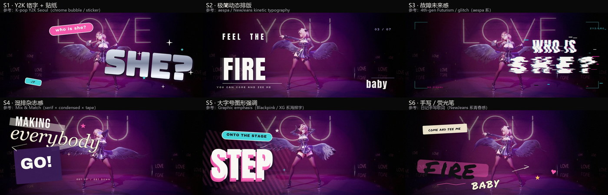
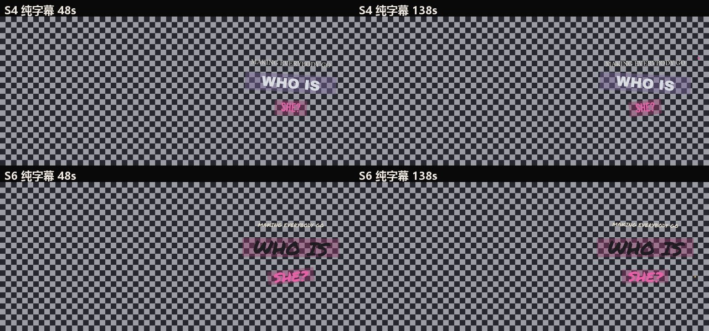

# dance-mmd-subtitle-kit · 舞蹈 MMD 字幕工具包

给 **MMD / 舞蹈视频** 批量制作「贴合画面、避开人物、有设计感」的艺术字幕：ASS 动画、风格方案、调色、避让、动态字、封面与壁纸，一整套可复用的脚本与流程文档。

> 本仓库是从实际项目（KISS OF LIFE《Who is she》MMD 舞蹈 PV）里整理出来的工具与踩坑总结。
> 视频、模型、歌曲、LRC 歌词等素材**不随仓库分发**；示例截图仅作演示。

---

## 特性

- **7 步流水线**：探测素材 → 选段 → LRC 对轴 → 定风格 → 写 ASS → 渲染 → 抽帧验收
- **5 个 Skill**（可被支持 `SKILL.md` 的 AI Agent 直接加载）：
  - `mmd-subtitle-pipeline`：总流程与交付规范
  - `ass-render-playbook`：ASS 硬规则 / ffmpeg 烧录 / 故障速查
  - `style-frames-compare`：S1–S6 风格库 + 静态帧 + 对比小样
  - `subject-color-grade`：突出人物的调色（光区塑形 / 硬抠像取舍）
  - `avoid-subtitles`：逐帧人物避让 + 0 重叠验收
- **脚本**：ASS 动画生成、风格静态稿（PIL/numpy）、调色、避让、透明叠加层、封面、对比视频、壁纸
- **透明字幕**：VP9 + alpha WebM 导出，可叠到任何画面上
- **Windows / ffmpeg 环境实测**（无 OpenCV、无深度学习依赖）

---

## 目录

```
dance-mmd-subtitle-kit/
├─ README.md
├─ LICENSE / LICENSE_NOTES.md
├─ requirements.txt
├─ .gitignore
├─ skills/                     # 5 个 SKILL.md + 索引
├─ scripts/                    # Python 脚本（Windows 路径，使用前改路径）
│  ├─ fonts/                   # 字体下载脚本（字体本体不入库，见 fonts/README.md）
│  ├─ subs_core.py / build.py  # 优雅版字幕生成 & 渲染
│  ├─ styles_anim.py           # S2/S4/S6 5s 动画小样
│  ├─ full_analysis.py         # 逐句人物包围盒分析
│  ├─ full_ass.py              # 全片 ASS 生成（按安全栏排版）
│  ├─ avoid_side2.py           # 完全不挡人：侧栏排版 + 逐帧复核
│  ├─ kpop_styles.py           # S1–S6 静态风格稿
│  ├─ art_frames.py            # 更炸的艺术字静态稿
│  ├─ grade_ffmpeg.py          # 调色（光区塑形 / 背景压暗）
│  ├─ flare_*.py / neon_*.py   # 炸场 / 霓虹动态字
│  ├─ make_covers*.py          # 封面（16:9 / 4:3 / 3:4）
│  └─ s4s6_compare.py          # 风格对比视频 + 关键帧表
├─ examples/
│  ├─ previews/                # 效果截图（演示用，不含原始素材）
│  └─ templates/               # LRC / cues 模板
└─ docs/
   ├─ PIPELINE.md              # 7 步流程详解
   ├─ STYLES.md                # S1–S6 风格与选型
   └─ LICENSE_NOTES.md         # 字体/素材/截图版权说明
```

---

## 快速开始

### 1. 环境

- **ffmpeg**（建议 6+，本项目用 Gyan full build 9.0；需要 libass / libvpx-vp9 / libx264）
- **Python 3.10+**：`pip install -r requirements.txt`（Pillow + numpy 即可）
- Windows 系统字体：**Georgia / Georgia Italic / Microsoft YaHei**（中文字幕用）

### 2. 字体

```powershell
cd scripts
powershell -ExecutionPolicy Bypass -File fonts\download_fonts.ps1
```
字体为 Google Fonts 开源字体（OFL/Apache），下载到 `scripts/fonts/`。

### 3. 准备素材

- 视频：MMD/舞蹈成片（本项目素材为 2560×1080 / 30fps）
- 歌词：LRC 文件（模板见 `examples/templates/lrc_template.txt`）
- 在 `scripts/*.py` 里把 `ROOT` / `SRC` / `OUT` 改成本机路径（脚本里默认是本项目旧路径）

### 4. 跑流程

```powershell
# 分析每句人物位置（全片）
python scripts/full_analysis.py

# 生成全片 S4/S6 两套 ASS
python scripts/full_ass.py

# 烧录（示例）
ffmpeg -i base.mp4 -vf "ass=_s4_full.ass:fontsdir=fonts" -c:v libx264 -crf 16 -pix_fmt yuv420p out.mp4

# 透明字幕（VP9 + alpha）
ffmpeg -f lavfi -i "color=c=black@0.0:s=2560x1080:r=30,format=rgba" ^
  -vf "ass=_s4_full.ass:alpha=1:fontsdir=fonts" -t 165.166 ^
  -c:v libvpx-vp9 -pix_fmt yuva420p -b:v 0 -crf 30 -row-mt 1 -auto-alt-ref 0 ^
  -metadata:s:v:0 alpha_mode=1 out_alpha.webm
```

具体参数与坑见 `skills/ass-render-playbook/SKILL.md`。

---

## 效果预览






---

## 已知限制

- 不做 AI 风格迁移 / 人体分割：本机无 cv2/深度学习依赖，调色与避让都是经典算法 + ffmpeg。
- 硬抠像会被人物投影污染（详见 `subject-color-grade`），舞台片建议用「光区塑形」方案。
- 全片 ASS 排版需要先跑人物包围盒分析；换片/换机位要重算，不能复用旧数据。
- 8bit 素材大幅推色会色带；透明 WebM 解码必须带 `-c:v libvpx-vp9`。
- 脚本里路径是本机 Windows 路径，跨平台/换目录请先改路径。

## 许可

- **代码**：MIT（见 `LICENSE`）
- **文档/技能**：CC BY 4.0（可自由复用，注明出处）
- **字体**：各自开源协议（OFL/Apache），见 `LICENSE_NOTES.md`
- **MMD 模型/场景/歌曲/歌词**：版权归原作者/权利方，仓库不包含这些素材；示例截图仅用于演示

---

## 发布到 GitHub

```bash
cd dance-mmd-subtitle-kit
git init
git add .
git commit -m "init: dance MMD subtitle kit"
git branch -M main
git remote add origin https://github.com/<你的账号>/dance-mmd-subtitle-kit.git
git push -u origin main
```

仓库建议：

- **名称**：`dance-mmd-subtitle-kit`
- **描述**：`Toolkit for MMD / dance video subtitles: ASS animation, styles, subject-aware color grade, character avoidance, ffmpeg rendering.`
- **Topics**：`mmd` `subtitles` `ass` `ffmpeg` `kpop` `dance-video` `pillow` `lyric-video`
- 克隆后先跑 `scripts/fonts/download_fonts.ps1` 下载字体；`.gitignore` 已排除媒体与字体文件。

